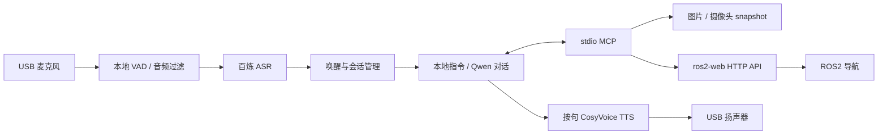

# Voice Assistant Client · 小云语音助手

面向 RK3566 / Armbian / Debian / Ubuntu 的 Python 中文语音助手，支持 USB 麦克风、扬声器、阿里云百炼问答、图片理解，以及通过 MCP 联动 ROS2 预设点导航。

配置统一保存在 **`config.yaml`** 中。对话、语音识别、语音合成和图片理解共用一个具有相应模型权限的 `DASHSCOPE_API_KEY`。

## 功能

- 默认通过“**你好小云**”唤醒，支持连续对话、超时休眠和“再见”结束对话。
- 本地 VAD 判断语音起止，过滤短促噪声、单独的“嗯 / en / 对 / 好”等应答，以及部分异常点位枚举识别结果。
- Qwen 文本流式返回，按句请求 CosyVoice 合成并依次播放。
- 识别上传图片或当前摄像头画面，输出中文描述、对象矩形框和中心点的像素坐标。
- 内置 stdio MCP 服务，提供图片识别、导航点查询、导航下发、取消导航和状态查询工具。
- 通过配套 ros2-web 的 HTTP 接口，按已保存的点位名称下发 ROS2 导航目标。
- 使用稳定 ALSA 声卡 ID，开机和 USB 热插拔时等待声卡就绪。
- 提供 systemd 服务、模型配置读写工具和自动化回归测试。

运行时仅使用 **Python 标准库**，无需第三方 Python 包。录音和播放依赖 Linux ALSA 工具。

## 工作流程



唤醒词由云端 ASR 识别后匹配；等待唤醒期间，满足 VAD 条件的录音片段也会提交给 ASR。当前实现为“断句后识别 + 文本流式生成 + 按句合成播放”，尚未实现全双工对话、播放中语音打断或离线唤醒。

## 环境要求

| 项目 | 要求 |
| --- | --- |
| 系统 | 可使用 ALSA 的 Linux；部署服务需要 systemd |
| Python | 3.10 或更新版本 |
| 音频 | USB 声卡、麦克风和扬声器；可分别配置输入输出设备 |
| 网络 | 可访问配置的百炼端点 |
| 图片来源 | 本地图片，或返回单帧图片的 HTTP snapshot 接口 |
| ROS2 导航 | 可选；另行部署具有下述导航 API 的配套 ros2-web 与 ROS2 导航节点 |

本仓库包含 Python 语音助手及其 MCP 服务。ros2-web 前后端、ROS2 工作空间和摄像头推流服务需要单独部署。

## 快速开始

以下命令在目标 Linux 设备执行，默认服务安装位置为 `/root/voice_assistant`。

### 1. 下载并安装系统依赖

```bash
sudo apt-get update
sudo apt-get install -y git python3 alsa-utils

git clone https://github.com/czu963889306-dev/voice_assistant_client.git /root/voice_assistant
cd /root/voice_assistant
cp config.yaml.example config.yaml
chmod 600 config.yaml
mkdir -p images
```

使用普通用户部署时，选择该用户有权限的目录，相应修改 systemd 服务中的路径和 `User`，并授予音频及摄像头设备访问权限。

### 2. 获取并填写百炼 API Key

1. 登录[阿里云百炼 API Key 控制台](https://bailian.console.aliyun.com/cn-beijing/model/settings/api-key)。
2. 选择所需地域，创建或复制可用的 API Key，确认已授权所用的语音、对话和视觉模型。
3. 编辑 `config.yaml`，填写 `DASHSCOPE_API_KEY`。

```yaml
DASHSCOPE_API_KEY: "在这里填写你的百炼 API Key"
```

API Key、接入域名和模型可用范围需要与所选地域匹配，不能跨地域混用。权限与获取步骤以[百炼官方说明](https://help.aliyun.com/zh/model-studio/get-api-key)为准。本程序直接读取 YAML，无需设置环境变量或创建 `.env`。

模板使用北京地域和以下模型名称；实际可调用的模型以账号授权和服务提供方为准：

| 用途 | 配置项 | 模板默认值 |
| --- | --- | --- |
| 对话 | `CHAT_MODEL` | `qwen-plus` |
| 语音识别 | `STT_MODEL` | `qwen3-asr-flash` |
| 语音合成 | `TTS_MODEL` | `cosyvoice-v3-flash` |
| 音色 | `TTS_VOICE` | `longanhuan_v3` |
| 图片理解 | `VISION_MODEL` | `qwen3-vl-plus` |

`BAILIAN_BASE_URL` 填写以 `/v1` 结尾的接口根地址，无需追加 `/chat/completions`。使用业务空间时，按服务配置填写 `BAILIAN_WORKSPACE_ID` 和 `BAILIAN_REGION`。

### 3. 选择音频设备

```bash
python3 assistant.py --devices
arecord -l
aplay -l
```

将输出中的稳定声卡 ID 填入配置，例如：

```yaml
INPUT_DEVICE: plughw:CARD=UACDemoV10,DEV=0
OUTPUT_DEVICE: plughw:CARD=UACDemoV10,DEV=0
MIC_VOLUME_PERCENT: 100
PLAYBACK_VOLUME_PERCENT: 100
```

`UACDemoV10` 是示例设备 ID，需要按实际硬件修改。按声卡 ID 选择设备能适应重启后的编号变化。

### 4. 自检并启动

```bash
python3 assistant.py --self-test
python3 assistant.py --text "现在几点"
python3 assistant.py --text "给我背一首诗"
python3 assistant.py
```

`--self-test` 仅报告配置、ALSA 工具位置和音频设备，不验证密钥有效性；检查 `arecord`、`aplay` 字段是否为空。`--text "现在几点"` 测试本地指令，其他文本可测试云端问答；文本模式不录音、不播放语音。

已有后台服务时，先停止服务再做前台音频测试，避免两个进程争用麦克风：

```bash
sudo systemctl stop voice-assistant
python3 assistant.py --once
sudo systemctl start voice-assistant
```

`--once` 录制并处理一段语音；配置了唤醒词时，该段语音也需包含唤醒词。

## 如何唤醒和对话

```text
你好小云
你好小云，给我背一首诗
看看当前画面有什么
识别图片 test.jpg，告诉我物体的位置
有哪些导航点
导航到A点
导航状态
停止导航
再见
```

唤醒后，在会话有效期内可直接说下一句。默认 30 秒无新对话会返回等待唤醒；“再见”结束当前会话。

| 配置项 | 默认值 | 含义 |
| --- | --- | --- |
| `WAKE_WORD` | `你好小云` | 唤醒词；留空后持续处理符合条件的语音 |
| `SESSION_TIMEOUT_SECONDS` | `30` | 会话空闲超时 |
| `STREAMING_RESPONSE` | `true` | 文本流式返回、按句合成播放 |
| `VAD_RMS_THRESHOLD` | `500` | 语音能量阈值，按麦克风环境调节 |
| `VAD_START_MS` | `80` | 触发录音所需的连续有声时间 |
| `VAD_MIN_VOICED_MS` | `240` | 录音片段至少包含的有声时间 |
| `VAD_SILENCE_MS` | `800` | 判断一句结束的静音时间 |
| `MAX_SPEECH_SECONDS` | `15` | 单段语音最长时长 |
| `IGNORE_FILLER_SPEECH` | `true` | 过滤单独的语气词 |
| `IGNORE_STANDALONE_ACK` | `true` | 过滤单独的“对 / 好 / 是 / 好的”等应答 |

轻声或短指令经常漏识别时，可逐步降低能量或有声时长阈值。过滤规则无法完全区分环境声和真实人声。

## 图片理解与像素坐标

### 本地图片

将图片放入 `images/` 后，通过 MCP 工具或语音识别：

```bash
python3 vision_tool.py
python3 vision_tool.py --image test.jpg
python3 assistant.py --text "识别图片 test.jpg"
```

不指定文件名时，`analyze_image` 选择 `images/` 顶层最新上传的图片；无上传图片且配置了摄像头来源时，获取当前画面。自带 `mcp_test.png` 仅供测试，不参与自动选择。

独立图片命令支持指定本地路径并保存 JSON：

```bash
python3 image_assistant.py /path/to/photo.jpg --json-out /path/to/result.json
```

返回格式示例（示意数据）：

```json
{
  "description": "桌面上有一个杯子",
  "width": 1280,
  "height": 720,
  "coordinate_system": "pixels",
  "objects": [
    {
      "label": "杯子",
      "bbox": [320, 180, 640, 540],
      "center": [480, 360],
      "confidence": 0.9
    }
  ]
}
```

坐标原点为原图左上角，x 向右、y 向下。`bbox` 为 `[x1, y1, x2, y2]`，`center` 为框中心。程序要求模型返回 0～1000 的归一化框，再换算成原图像素坐标；框与置信值均为模型估计。

MCP 图片入口限制为 `VISION_IMAGE_DIR` 内的文件，检查符号链接解析后的路径，单张图片不超过 10 MiB、4000 万像素。只有实际调用识别工具时才会向百炼提交相应图片。

### 通过 snapshot 获取当前画面

设备已有摄像头推流服务时，配置单帧接口：

```yaml
VISION_MCP_ENABLED: true
VISION_SOURCE: snapshot
VISION_SNAPSHOT_URL: http://127.0.0.1:8080/snapshot
VISION_SNAPSHOT_TIMEOUT_SECONDS: 8
```

摄像头在另一台设备时，把 `127.0.0.1` 换为对应设备地址。接口必须返回单张图片，不能是 HTML 页面或 MJPEG 连续视频流。

```bash
python3 vision_tool.py --current
python3 assistant.py --text "看看当前画面有什么"
```

每次识别都会重新取图，结果标注 `source_kind: snapshot` 和 `fetched_at`；后者是获取时间，不是摄像头曝光时间。取图失败会报错，识别后的临时图片会清理。此模式无需 ffmpeg，也无需语音助手直接占用摄像头。

| `VISION_SOURCE` | 用途 |
| --- | --- |
| `none` | 不启用当前画面来源，仍可识别上传图片 |
| `file` | 读取 `VISION_FRAME_FILE` 测试图片，结果标为测试来源 |
| `camera` | 使用 ffmpeg 直接采集 `VISION_CAMERA_DEVICE`，需单独安装 ffmpeg |
| `snapshot` | 请求现有 HTTP 单帧图片接口 |

直接采集时，用 `v4l2-ctl --list-devices` 确认摄像头节点，使用 `/dev/v4l/by-id/` 固定链接，并按设备能力配置格式、分辨率和帧率。已有服务占用摄像头时使用共享 snapshot 接口。

## MCP 与 ROS2 导航

启用 `VISION_MCP_ENABLED` 后，助手自动启动 `vision_mcp.py` 子进程，通过 UTF-8、按行 JSON-RPC 的 stdio 连接加载工具，无需另开 MCP 网络端口。

| 工具名称 | 功能 |
| --- | --- |
| `analyze_image` | 识别指定图片或最新上传图片 |
| `inspect_current_view` | 获取并分析当前画面 |
| `vision_status` | 查询图片和画面来源配置，不取图 |
| `list_navigation_points` | 查询 ros2-web 保存的导航点 |
| `navigate_to_point` | 按点位名称请求下发导航目标 |
| `cancel_navigation` | 请求停止当前导航目标 |
| `get_navigation_status` | 查询实际导航状态及剩余距离 |

其他运行在同一 Linux 设备上的 MCP 客户端可配置：

```json
{
  "mcpServers": {
    "xiaoyun-assistant": {
      "command": "/usr/bin/python3",
      "args": [
        "/root/voice_assistant/vision_mcp.py",
        "--config",
        "/root/voice_assistant/config.yaml"
      ]
    }
  }
}
```

### 导航配置

```yaml
VISION_MCP_ENABLED: true
NAVIGATION_MCP_ENABLED: true
ROS2_WEB_API_URL: http://127.0.0.1:3000/api
```

1. 在配套 ros2-web 中选择地图，启动导航并完成初始定位。
2. 在当前地图保存有名称的点位，例如 `A点`、`B点`、`一号位`。
3. 唤醒后说“有哪些导航点”，再说“导航到A点”。
4. 用“导航状态”查询进展，“停止导航”取消当前目标。

ROS2 不在本机时，`ROS2_WEB_API_URL` 填写导航 API 的设备地址。语音助手本身无需导入 ROS2 Python 包。

客户端调用以下配套接口；普通 ros2-web 项目若缺少这些接口，需要先实现对应服务：

| 方法 | 相对 `/api` 的路径 | 请求 / 响应约定 |
| --- | --- | --- |
| GET | `/navigation/points` | 返回 `success`、`activeMap`、`points`；点位包含 `name`、`mapPath` |
| GET | `/navigation/state` | 返回 `success`、`status`，可附 `distance_remaining` |
| POST | `/navigation/go-to` | 请求 `{"name":"A点"}`；成功需返回 `success: true`、`submitted: true` |
| POST | `/navigation/cancel` | 请求 `{}`；成功需返回 `success: true`、`submitted: true` |

明确的导航指令由规则解析后调用 MCP，使用服务器保存的点位，避免让模型生成目标坐标或虚构执行结果。下发成功只表示目标已提交；只有导航节点返回 `ARRIVED` 才表示报告到达。未知点、地图不匹配、未定位或服务错误会明确反馈。

## 开机启动与日志

以下命令对应默认安装目录 `/root/voice_assistant`：

```bash
sudo cp voice-assistant.service /etc/systemd/system/
sudo systemctl daemon-reload
sudo systemctl enable --now voice-assistant

systemctl status voice-assistant --no-pager
systemctl is-enabled voice-assistant
journalctl -u voice-assistant -f
```

修改配置后执行 `sudo systemctl restart voice-assistant`。连续模式在声卡尚未出现时等待，并在设备恢复后继续录音。日志包含识别结果、MCP 调用、合成与播放耗时，以及录音失败时的 ALSA 原始错误。

配套 ros2-web 可通过 `model_settings.py` 读取或更新模型配置；本仓库不提供网页。读取结果仅返回密钥是否已配置，保存时空密钥保持原值，其他字段经白名单验证后原子写入：

```bash
python3 model_settings.py read /root/voice_assistant/config.yaml
```

## 常见问题

| 现象 | 检查方向 |
| --- | --- |
| 录音进程提前退出 | 用 `--devices` 检查声卡 ID、USB 连接和占用，查看 ALSA 原始错误 |
| 经常识别“嗯” | 按环境调节 VAD，保留语气词过滤，使用“继续背诗”等完整指令 |
| 扬声器音量低 | 检查 `OUTPUT_DEVICE`、`PLAYBACK_VOLUME_PERCENT`、`alsamixer` 和功放音量 |
| 图片识别提示没有来源 | 检查 `VISION_SOURCE`，确认 snapshot 接口返回有效单帧图片 |
| 播报下发成功但未移动 | 查看 `submitted`、实际导航状态、当前地图和初始定位 |
| 对话长时间等待 | 检查网络、端点与密钥权限，按日志区分模型、TTS、下载及播放耗时 |
| 开视频后网关延迟升高 | 排查重复网页视频连接和 MJPEG 带宽；图片 MCP 仅按需取单帧 |

网络请求默认优先 IPv4，保留 IPv6 回退；可通过 `HTTP_CONNECT_TIMEOUT_SECONDS`、`HTTP_READ_TIMEOUT_SECONDS`、`TTS_TIMEOUT_SECONDS` 调整等待时间。HTTPS 证书验证保持开启。

当前没有独立的实时天气数据工具，不能把普通模型生成的天气回答视为实时天气播报。

## 项目结构

```text
.
├── assistant.py              # 语音、会话、ASR、流式对话与 TTS
├── config.yaml.example       # 配置模板；实际 config.yaml 被忽略
├── http_transport.py         # IPv4 优先、连接预算与 HTTPS 请求
├── image_assistant.py        # 独立图片理解与像素坐标转换
├── mcp_client.py             # stdio MCP 客户端
├── vision_mcp.py             # 图片与导航 MCP 服务入口
├── vision_tool.py            # 图片 MCP 命令行入口
├── navigation_tools.py       # 导航指令解析与 ros2-web 接口适配
├── model_settings.py         # 模型配置读取、验证和原子保存
├── model_catalog.py          # 配套网页使用的模型与端点选项
├── voice-assistant.service   # systemd 服务模板
├── images/mcp_test.png       # 合成测试图片
├── requirements.txt          # 说明：无需第三方 Python 依赖
└── tests/                    # unittest 回归测试
```

## 测试

在工程目录执行：

```bash
python3 -m unittest discover -s tests -v
python3 -m compileall -q .
```

回归测试使用模拟请求和临时文件，覆盖唤醒与标点处理、静音过滤、SSE 分句、图片坐标、MCP 通信、导航结果和配置保存，不需要真实 API Key，也不会实际驱动机器人移动。真实音频、云端模型和底盘需在目标设备另行联调。

## 配置与数据管理

实际 `config.yaml`、录音、日志、用户图片、缓存和备份文件由 `.gitignore` 排除。只提交 `config.yaml.example`，在每台设备分别填写密钥和硬件配置。发布代码不会替换现有设备上的密钥。

程序只解析当前模板所用的扁平 YAML 标量，不支持嵌套 YAML 对象或数组。
